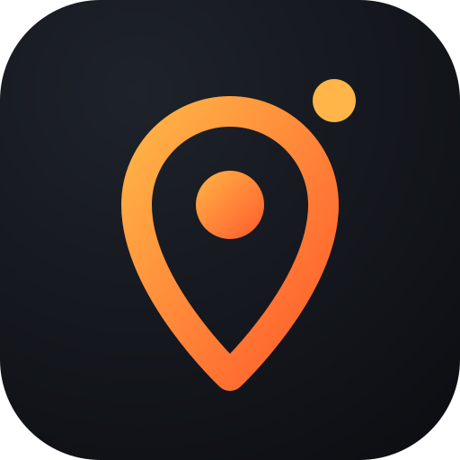
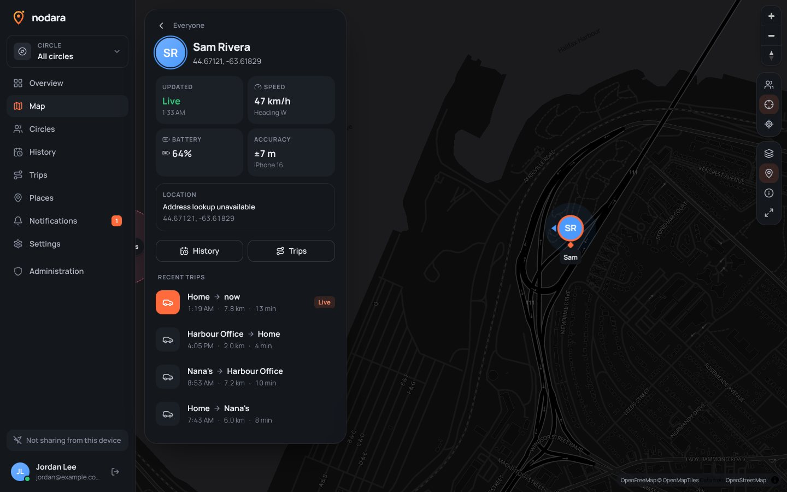
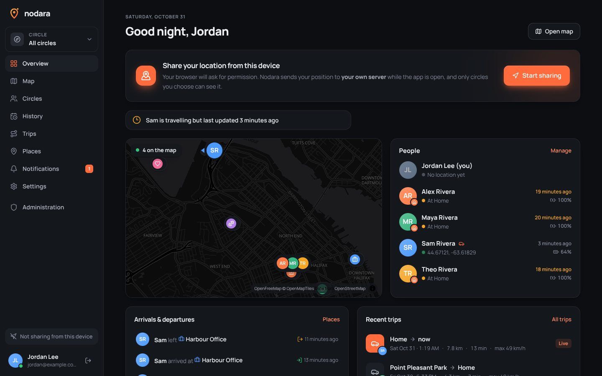
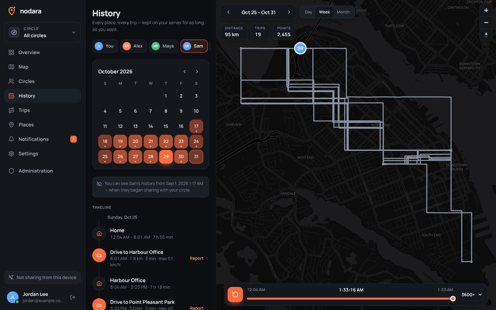
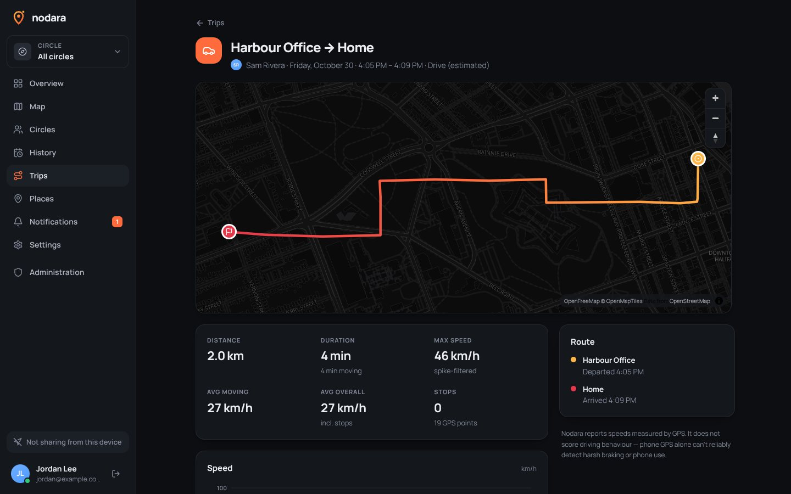
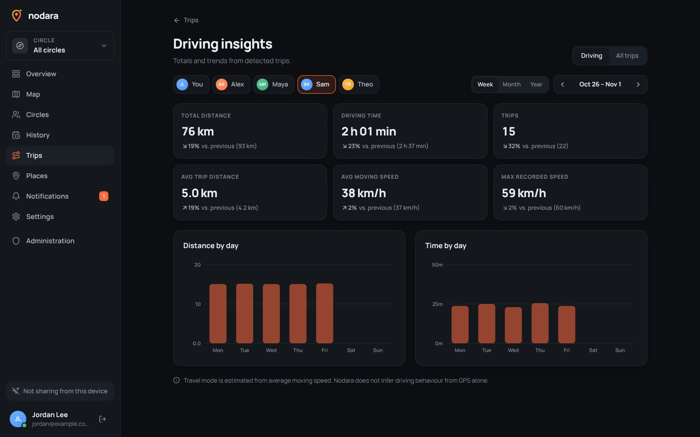
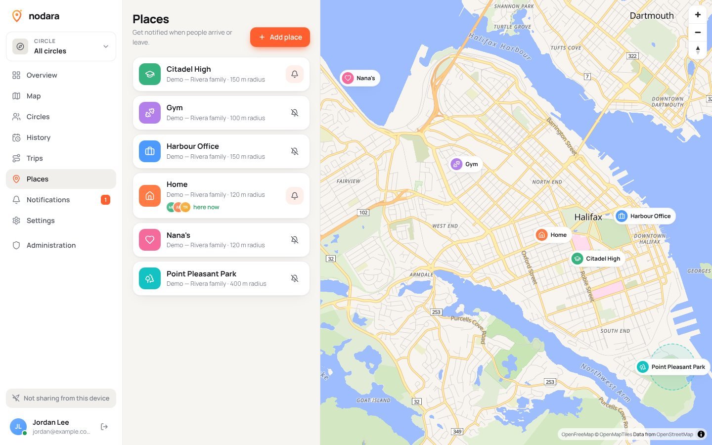
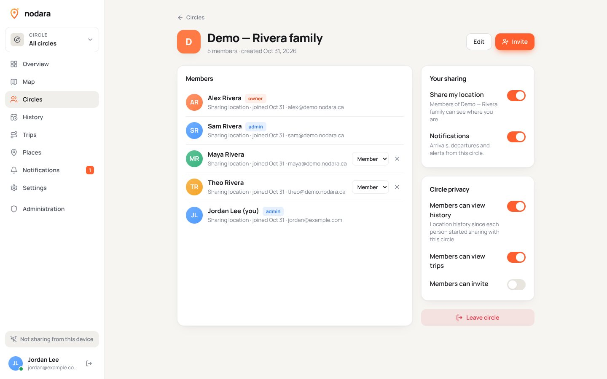
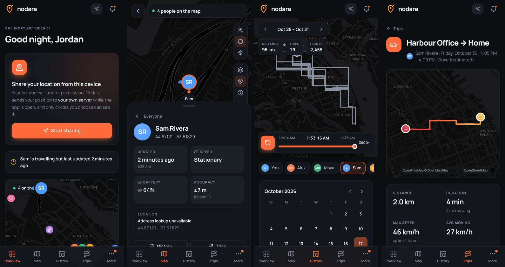

<div align="center">



# Nodara

**Your people. Your places. Your data.**

Self-hosted location sharing, family safety & personal mobility — an open-source, privacy-first alternative to commercial family-locator apps.

[](#-please-read-this-first)
<br />
[](LICENSE)


</div>

---

> [!CAUTION]
> ## ⚠️ Please read this first
>
> ### **This project was created mainly with AI. I am not a professional developer.**
>
> Most of Nodara's code, design and documentation was generated with an AI coding assistant (Claude) under my direction. I review, test and steer it, but **I am not a professional software engineer**, and this code has **not** had an independent security audit.
>
> Nodara handles **real-time location data about real people**. Please treat it as an early, experimental project:
>
> - Read [SECURITY.md](SECURITY.md) and [the threat model](docs/security.md) before trusting it with your family's data.
> - Run it behind HTTPS, keep backups, and keep it updated.
> - Expect bugs. Reports, reviews and fixes from experienced developers are **very** welcome — see [CONTRIBUTING.md](CONTRIBUTING.md).

---

<p align="center">
  
</p>

<table>
  <tr>
    <td width="50%"></td>
    <td width="50%"></td>
  </tr>
  <tr>
    <td></td>
    <td></td>
  </tr>
  <tr>
    <td></td>
    <td></td>
  </tr>
</table>

<p align="center"></p>

<sub>Screenshots use the built-in, clearly-flagged demo family (`pnpm seed:demo`) — no real people.</sub>

## Why Nodara?

Commercial family-locator apps work well, but they put everyone's location history on someone else's servers, show ads, and lock your own history behind subscriptions. Nodara is the same category of product, built so that:

- **You own the server.** One `docker compose up`, a PostgreSQL database, and that's it.
- **History is never paywalled or artificially limited.** Keep it forever, or set your own retention.
- **No ads, no data sales, no mandatory third-party services, no telemetry by default.**
- **Everyone stays in control** of which circles can see them, and can pause at any moment.

## Features

Everything below is implemented and wired to the real backend — there is no fake data in the product UI.

| | |
|---|---|
| **Live map** | Real-time member locations over WebSockets, avatars with direction arrows, accuracy circles, freshness indicators (live / recent / out of date), marker grouping, follow mode, multiple map styles, legend, full-screen. Stale coordinates are always labelled as *last known*, never as live. |
| **Circles** | Multiple independent circles, roles (owner / admin / member), secure expiring invitation links with use limits, per-circle sharing and notification settings, privacy settings (history / trips visibility, who can invite). |
| **Location history** | Calendar with activity heat, day / week / month views, timeline of stays and trips, playback with scrubbing and speed control, point inspection, distance totals, GPX/GeoJSON/CSV/JSON export. Large ranges are decimated server-side. |
| **Trips** | Automatic trip detection (start/end, route, stops, distance, duration, moving time, max / average speed), filtering of GPS jitter, low-confidence flags, per-trip reports with route map and speed graph. |
| **Speed** | GNSS speed preferred, distance-derived speed as fallback, spike filtering, stationary-noise suppression, km/h or mph, estimated values clearly marked. |
| **Places & geofences** | Search or drop a pin, radius, icon, colour, private or shared with a circle. Arrive/leave detection with hysteresis, cooldown and duplicate prevention; per-member alert subscriptions. |
| **Notifications** | In-app notification centre (read/unread), realtime toasts, Web Push (VAPID keys generated automatically), arrivals, departures, circle joins, sharing changes, low battery, device offline. Per-type preferences. |
| **Driving insights** | Weekly / monthly / yearly totals with comparisons, distance and time charts. Travel mode is estimated and labelled as such; Nodara does **not** pretend to score driving behaviour from GPS. |
| **Accounts & security** | Argon2id passwords, server-side sessions, TOTP 2FA with recovery codes, passkeys (WebAuthn), password reset, email verification (optional SMTP), session management, account deletion, rate limiting, CSRF protection, audit log. |
| **Devices** | Browser/PWA tracking, plus device tokens for **OwnTracks** and **Overland** today (real background tracking on iOS/Android) and future native apps — all through the same ingestion API. |
| **Administration** | System status, database & storage stats, ingestion stats, user management (create, disable, promote, reset links), registration policy (open / invite / closed), retention, opt-in anonymous telemetry with a full payload preview, audit log, demo-data removal. |
| **PWA** | Installable, offline app shell, cached map tiles, push notifications, responsive phone / tablet / desktop layouts, light & dark themes. |

### iOS app (early)

`apps/mobile` is a native iOS app built with Expo: real background location, geofence wake-ups, push notifications and a Liquid Glass UI. It hasn't been tested on a physical iPhone or published yet. To build and install it, see **[apps/mobile/README.md](apps/mobile/README.md)**.

### Honest limitations

- **Browsers cannot track you reliably in the background.** iOS Safari stops sharing as soon as Nodara is not on screen; Android pauses after a while. Nodara says so in the UI and never shows stale data as live. For continuous background sharing use the **[iOS app](apps/mobile/README.md)** (early) or connect **[OwnTracks or Overland](docs/clients.md)**. Details: [docs/background-location.md](docs/background-location.md).
- **Geofence alerts depend on the device reporting.** If a phone isn't sending locations, the server can't know it arrived.
- **No crash detection, SOS, or driving-behaviour scoring** — these need reliable native sensors and are not claimed.
- **Address lookup is optional** and needs a Nominatim-compatible geocoder you configure.

## Quick start (Docker Compose)

```bash
git clone https://github.com/solynx-dev/nodara.git && cd nodara
cp .env.example .env
# Edit .env: set PUBLIC_URL, SESSION_SECRET (openssl rand -base64 32) and POSTGRES_PASSWORD
docker compose up -d --build
```

Nodara now listens on `127.0.0.1:8080`. Put HTTPS in front of it (browsers only allow location, push and passkeys on secure origins):

```bash
# Option A: the bundled Caddy profile — automatic Let's Encrypt certificates
#   set NODARA_DOMAIN in .env and point DNS at this machine, then:
docker compose --profile caddy up -d

# Option B: your own reverse proxy — see docs/deployment.md (nginx, Caddy, Traefik)
```

Open your `PUBLIC_URL`, create the administrator on the first-run screen, create a circle, and send an invite link. On a phone, open Nodara and choose **Add to Home Screen** to install it.

Full guide: **[docs/deployment.md](docs/deployment.md)** · Configuration: **[docs/configuration.md](docs/configuration.md)** · Backups: **[docs/backup-restore.md](docs/backup-restore.md)**

### Try it with demo data

```bash
docker compose exec nodara node dist/cli/seed-demo.js --join you@example.com
```

This adds a clearly-flagged demo family with two weeks of history to a separate circle and adds your account to it. Remove it any time in **Administration → System → Remove demo data**.

## Development

Requirements: Node 22+, pnpm 10, PostgreSQL 16 with PostGIS 3.

```bash
pnpm install
createdb nodara && psql nodara -c 'CREATE EXTENSION postgis'   # or: docker compose up -d db
pnpm --filter @nodara/server dev    # API on :8080 (migrations run automatically)
pnpm --filter @nodara/web dev       # Web on :5173, proxies /api to :8080
pnpm seed:demo -- --join you@example.com
```

Tests: `pnpm test` (unit + API integration against PostgreSQL) and `pnpm test:e2e` (Playwright, desktop + mobile). See **[docs/development.md](docs/development.md)**.

## Architecture

A modular monolith — one Node.js process, one PostgreSQL/PostGIS database, no Redis, no microservices.

```
apps/server     Fastify + TypeScript REST API, WebSockets, background jobs, SQL migrations
apps/web        React + Vite + Tailwind PWA, MapLibre GL maps
apps/mobile     Expo / React Native iOS app (npm, outside the pnpm workspace)
packages/shared Types, geo math and unit formatting shared by both
```

Read **[docs/architecture.md](docs/architecture.md)** for the data model, ingestion pipeline, trip detection, geofencing and realtime design, and **[docs/api.md](docs/api.md)** for the REST/WebSocket API.

## Privacy & security

- Location data is stored **only** on your server. The only outbound requests are map tiles (configurable — self-host your own), optional geocoding (proxied and cached by the server so browsers never talk to the geocoder), optional SMTP, and Web Push delivery via the browser vendor's push service (end-to-end encrypted).
- Telemetry is **off** by default, requires an administrator to enable it **and** an endpoint to be configured, and never includes coordinates, addresses, names, emails, device IDs or circle details. The exact payload is shown in the admin UI.
- Every endpoint enforces circle-level authorization; isolation is covered by automated tests.
- People can only see your history **from the moment you started sharing with their circle**, and never what you recorded while paused.

See **[SECURITY.md](SECURITY.md)** and **[docs/security.md](docs/security.md)**.

## Nodara Cloud (future, optional)

Nodara is and will remain a self-hosted, open-source project. A possible future **Nodara Cloud** would offer an officially hosted instance (proposed **$4.99 CAD/month for a family of up to 5**) for people who don't want to run a server — paying for hosting and maintenance, **never** for features or access to your own history. Self-hosted and hosted run the same code with no feature differences, and cloud users can always export and move to self-hosting. Nothing about it is built yet. Details: **[docs/cloud-edition.md](docs/cloud-edition.md)**.

## Roadmap

Native iOS/Android apps with reliable background tracking, native push, background geofencing, SOS alerts, temporary/scheduled sharing, more map providers… See **[docs/roadmap.md](docs/roadmap.md)** for the plan and the implementation checklist.

## Contributing

Issues and pull requests are welcome — especially security reviews, accessibility fixes and testing on real devices. Please read **[CONTRIBUTING.md](CONTRIBUTING.md)**.

## License

Nodara is licensed under the **GNU Affero General Public License v3.0** ([LICENSE](LICENSE)). If you run a modified version as a network service, you must offer its source to your users.

Map data © [OpenStreetMap](https://www.openstreetmap.org/copyright) contributors. Default vector tiles by [OpenFreeMap](https://openfreemap.org).
