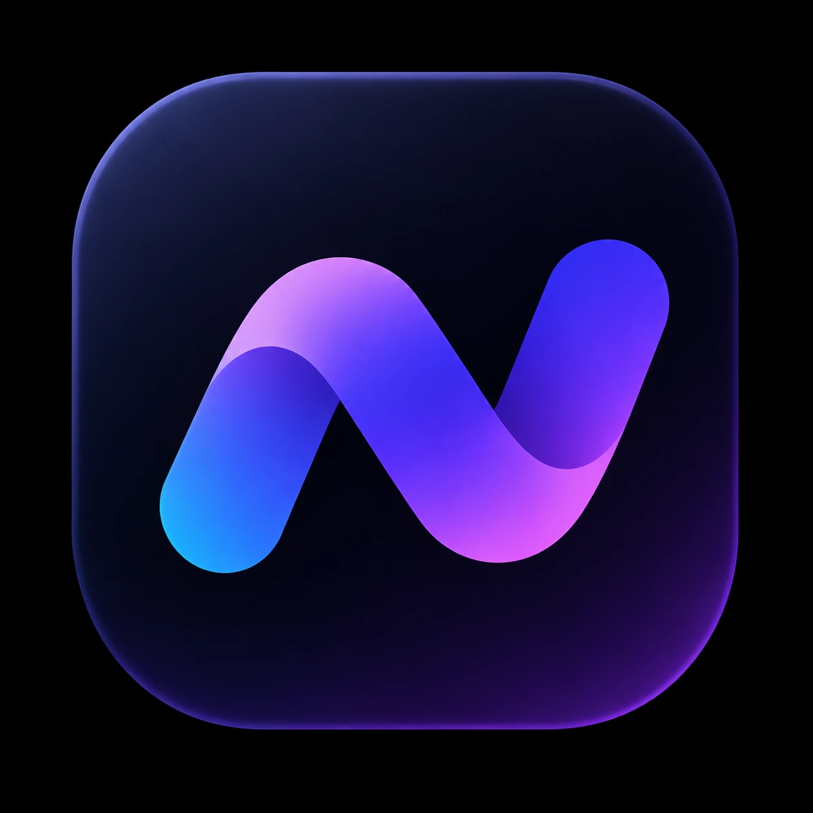

# Nodara brand

A premium, minimal identity: a gradient **N** on midnight navy. Purple is the one
interactive colour; the blue-to-pink gradient is a signature, used sparingly.

## Colours

| Token | Hex | Use |
|---|---|---|
| Primary (Vibrant Purple) | `#6D3EF5` | Primary buttons, active navigation, selected controls, toggles, focus rings, the selected person on the map |
| Primary hover | `#5930DA` | Hover/pressed buttons; accent text on light backgrounds |
| Secondary (Royal Indigo) | `#3967FF` | Info states, secondary charts |
| Electric Blue | `#1FB6FF` | Gradient start; the start of a route |
| Bright Violet | `#9342FA` | Gradient |
| Accent Pink | `#D94FF5` | Gradient end; the end of a route; **Bubbles** (privacy areas), so they never look like a button |
| Lavender | `#A98EFF` | Accent text and icons on dark surfaces (purple itself is too dark there) |
| Dark background | `#0B0D1C` | Dark-mode app background (never pure black) |
| Dark surface | `#16182D` | Dark-mode cards, cells, sheets |
| Dark border | `#2A2B46` | Dark-mode separators and borders |
| Primary text (dark) | `#F8F9FF` | |
| Muted text (dark) | `#A6ABC5` | |
| Light background | `#F7F7FB` (web) / `#F4F3FA` (iOS grouped) | Off-white with a faint violet tint |

Semantic colours stay semantic: green for success/live, amber/orange for warnings
and stale data, red for errors and destructive actions.

**Gradient:** `linear-gradient(120deg, #1FB6FF 0%, #3967FF 32%, #9342FA 70%, #D94FF5 100%)`.
Use it for the logo, the sign-in hero, one headline word, and route lines on maps.
Not for buttons, body text or large backgrounds.

## Contrast (WCAG AA)

| Pair | Ratio |
|---|---|
| White on `#6D3EF5` (buttons) | 5.7:1 |
| White on `#5930DA` | 7.3:1 |
| `#5930DA` text on white | 7.3:1 |
| `#A98EFF` text on `#16182D` | 6.7:1 |
| `#A6ABC5` muted text on `#16182D` | 7.7:1 |
| `#666B88` muted text on white (web light) | 4.6:1 |
| `#5E6280` secondary text on `#F4F3FA` (iOS light) | 5.4:1 |
| White on `#A932C4` (bubble button) | 5.3:1 |

Gradient text is only used at 24 px+ bold (large text, 3:1).

## Where the tokens live

- **Shared constants:** `packages/shared/src/brand.ts` (server pages, emails, web maps/SVG).
- **Web:** CSS variables in `apps/web/src/styles.css` (`--accent`, `--accent-text`, `--bubble`, `--brand-gradient`, …) exposed as Tailwind colours (`bg-accent`, `text-accent-text`, `bg-brand-gradient`, `text-brand-gradient`, `bg-midnight`…).
- **iOS:** `apps/mobile/src/lib/theme.ts` — `BRAND` and the light/dark tokens in `C` (`C.accent` for fills, `C.accentText` for text and icons, `C.bubbleText`), plus `NAV` for navigation chrome.

## Assets

- `nodara-logo.png` — the official logo (gradient N on its tile).
- `nodara-mark.png` — the N alone, transparent background.
- `nodara-icon-rounded.png` — the app icon with rounded corners.

App and web icons (`apps/mobile/assets/*`, `apps/web/public/*.png`) are all generated from the official logo, so the N is identical everywhere.
